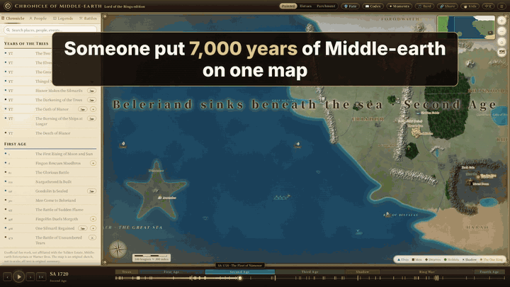

# Chronicle of Middle-earth · 中洲纪年

**7,000 years of Tolkien's world on one interactive 2.5D & 2D map. Drag the timeline and watch Beleriand sink, Númenor rise and fall, and the War of the Ring play out.** Every terrain heightfield, 3D monument, pixel-art forest, portrait, and scene is drawn in code: no image files, no dependencies, no build step.

**[▶ Open the interactive map in your browser](https://shangliy.github.io/chronicle-of-middle-earth/?lang=en)** · [中文版](https://shangliy.github.io/chronicle-of-middle-earth/?lang=zh) · [简体中文说明](#简体中文) · [English docs](#english)

[](https://shangliy.github.io/chronicle-of-middle-earth/?lang=en)

[](https://shangliy.github.io/chronicle-of-middle-earth/?lang=en)
[](LICENSE)


**Try these in the first 30 seconds:**

- **Right-drag / `Q` / `E` & scroll way in** to explore the WebGL2 2.5D diorama up close—fly down beside 3D Minas Tirith, Númenor, Barad-dûr, or pixel-art wind-swept forests, or click `🕊` for golden-hour orbit cruise.
- Press `Space` to play history from the Years of the Trees to the Fourth Age.
- Press `W` to put on the One Ring and see the Unseen World.
- Press `B` to light the 3D beacons of Gondor along the White Mountains.
- Press `3` to toggle seamlessly between **2.5D WebGL2 Diorama** and **2D Map** (with 3 hand-made map styles: painted relief, heroic adventure, old parchment).
- Open one of 37 illustrated key moments or 6 playable battle maps, such as [the Pelennor Fields](https://shangliy.github.io/chronicle-of-middle-earth/?lang=en#b=pelennor).

**Run it locally:** `git clone https://github.com/shangliy/chronicle-of-middle-earth && cd chronicle-of-middle-earth && python3 -m http.server 8000`, then open <http://localhost:8000>.

If you enjoyed wandering through it, a ⭐ helps other Tolkien fans find it.

---

<a id="简体中文"></a>

## 简体中文

本项目从 [`shangliy/chronicle-of-commerce`](https://github.com/shangliy/chronicle-of-commerce) 独立拆出为专属仓库，并在原版基础上完成了 **托尔金泥金手稿风（Illuminated Manuscript Edition）UI 与程序化美术全面重绘**。全站采用 **纯静态 HTML + CSS + SVG + Canvas + WebGL2 + Web Audio** 构建，零外部图片资源、零构建打包依赖，开箱即用。

### ✨ 核心特性

- **⛰️ WebGL2 2.5D 立体沙盘（默认启动，按 `3` 无缝切回 2D）**：
  - **纯代码 3D 地形与 10 座程序化 3D 奇观建筑**：无任何外部 3D 模型或贴图，实时构建米那斯提力斯七层白城、努门诺尔（阿美尼洛斯环城运河与黄金穹顶神殿）、巴拉督尔黑塔与炽燃魔眼、艾森加德欧尔桑克、圣盔谷号角堡、孤山矮人大门、刚多林、提力安、埃多拉斯金殿与阿刚那斯双王巨像；支持低空贴地近距细节探索与 `🕊` 黄金时刻自动环绕巡游。
  - **像素美学分层风吹森林**：采用静止树干 + 暗影内冠 + 多团独立像素叶簇架构，`NEAREST` 锐利像素采样与逐像素步进的行波阵风/静风周期，让范贡、黑森林、罗斯洛立安与伊希利恩在微风中立体摇曳。
  - **黄金时刻天光与水底焦散**：动态 3D 太阳光盘、双层浅水折射焦散、Beer-Lambert 水深吸收、山脉光线步进软阴影，以及随时间轴实时沉没入海的贝烈瑞安德与努门诺尔。
- **🌍 跨纪元动态大陆地图**：从双树纪、第一纪元（贝烈瑞安德沉没前）、第二纪元（努门诺尔升起与陆沉）、第三纪元（魔戒圣战）直至第四纪元，海岸线、迷雾帷幕、王国疆域纹章与天光随时间轴实时演变。
- **🎨 2D 三套程序化地图画风（切至 2D 后一键切换）**：
  - **手绘山河 (`paint`，默认)**：脊状多重分形（Ridged Multifractal）山脉光影浮雕（晨昏暖脊 + 幽谷冷影 + 火山岩浆辉光）、立体微缩地标建筑与动态阵营旗帜。
  - **英雄冒险 (`h3`)**：致敬经典回合制奇幻策略游戏的饱满无缝地形贴图、金边石框界面、英雄四维属性面板与大陆生态物件。
  - **古卷羊皮 (`parch`)**：古典钢笔排线海岸、红黑双色衬线标注与泛黄羊皮纸卷轴质感。
- **🧙 77 位人物泥金肖像与大陆足迹**：
  - 程序化矢量半身像，配备 **六大阵营专属泥金画框**（精灵秘银星拱、矮人卡扎督姆几何符文框、人类刚铎金拱、霍比特夏尔暖铜框、迈雅圣光星环、暗影黑铁尖刺铆钉框）及 **13 位核心角色专属信物细节**（如弗罗多的魔戒金链与刺针蓝光、费艾诺三宝钻、图林金龙盔与黑剑古山格、阿拉贡精灵宝石胸针等）。
  - 侧栏支持 **种族胶囊筛选** 与即时检索；点击「足迹」即可在地图上跟随护戒同盟、五军、洛汗铁骑等行军与迁徙路线。
- **📖 12 部引导式传说 & 37 幅关键时刻宽银幕插画**：
  - 12 部传说卡片与阅读器扉页均配有专属 **泥金木刻圆章** 与泥金首字下沉排版，翻页时镜头自动飞往事发地并拨动纪元时间。
  - 37 幅 `1200×520` 四层空气透视宽银幕插画（费艾诺三宝钻起誓、长湖镇史矛革火海、布茹伊能白马洪流、努门诺尔陆沉、甘道夫断桥阻炎魔、巨鹰救主、圣白树开花加冕等），时间轴播放至关键节点可自动驻留展示。
- **⚔️ 6 场可交互战术沙盘推演**：
  - 涵盖无尽眼泪之战、最后同盟之战、五军之战、圣盔谷之战、帕兰诺平原之战、黑门之战，均配专属战旗纹章。
  - 支持第一人称小兵视角抉择、点击友军随行/敌军突击、齐射/号角/冲锋战术指令，以及基于 Web Audio 实时合成的号角、箭雨与兵刃音效。
- **🔮 趣味探索、小游戏与沉浸式彩蛋**：
  - **🔥 点燃刚铎七座烽火 (`B` 键 / 点击白山烽火台)**：从阿蒙丁到哈利费理安逐峰点燃白色山脉求援烽火，唤醒洛汗铁骑驰援帕兰诺。
  - **🚪 叩响卡扎督姆西门（伊希尔丁月光密语）**：在摩瑞亚或红皮书手札中念诵精灵语密语 `Mellon`（朋友），亲手开启凯勒布理鹏与纳尔维锻造的星光石门。
  - **真知晶石漫游 (`🔮 漫游` / `R`)**：智能加权抽取尚未造访的关键时刻、名城与秘境地标，带晶石闪耀与镜头平滑漫游。
  - **至尊戒编年与「幽影视界」(`◉ 至尊戒` / `W`)**：实时查看当前纪年持戒人，戴上至尊戒即可进入反色幽蓝与魔戒火字旋转笼罩的幽影界（Unseen World）。
  - **西境红皮书探索手札 (`📖 手札`)**：自动记录城邦地标、人物传记、关键时刻与战役探索进度，解锁 **10 枚原创 SVG 泥金火漆印章**。
  - **🕯️ 黑暗中的猜谜（比尔博 vs 咕噜小游戏）**：内置于红皮书手札、比尔博/咕噜人物卡及咕噜暗湖地标中的原著六道经典谜语对决，配动态双人立绘舞台与咕噜台词反馈。
  - **🎵 纪元自适应吟游竖琴、风物明信片与视角分享 (`🔗`)**：零外部音频依赖的 Web Audio 竖琴/长笛氛围曲；每座城邦、地标与 15 类动态奇观均配有彩绘明信片横幅；支持一键复制当前纪元与镜头坐标的永久分享链接。
- **🧒 小朋友寻宝模式**：大字号卡片、语音朗读支持、十关地图寻宝问答与贴纸收集册。
- **🌐 中英双语完整覆盖**：顶栏一键切换 `中文 / EN`（或通过 `?lang=en` 访问）。

### 🖼️ 独立版 UI 与美术升级亮点

1. **都林星拱与流火至尊戒封面**（`index.html`, `css/me.css`）：移除原合集站无关链接，新增都林之门式精灵星拱背纹、浮动星尘与魔多余烬微粒、多层金属倒角 + 腾格瓦流线火字至尊戒、泥金章节牌匾按钮与封面画风直选器。
2. **独立版顶栏与全画风鹰眼小地图**（`js/me.js`, `js/me-i18n.js`）：左置至尊戒立体徽章（随时返回封面），右置三段式画风切换器与 `✦ 时刻` 快捷入口；右上角鹰眼总览小地图现支持全部三种画风，带至尊戒脉冲金点定位与 `🗺` 显隐开关，左下角重绘努门诺尔十六风向航海罗盘。
3. **关键时刻四层透视与定制叙事画卷**（`js/me-scene.js`）：升级天穹流云、远山雾影、受光建筑倒影与人物轮廓背光，并为十余幕核心名场面绘制专属叙事主体。
4. **双圣树、3D 微缩地标与生灵奇观精修**（`js/me-models.js`, `js/me-life.js`, `js/me-relief.js`）：重绘埃泽洛哈绿丘上的银树与金树及光露双池；考据升级米那斯提力斯（首层黑石外墙 + 七层白城 + 白树）、巴拉督尔（熔岩壕沟 + 烈焰竖瞳）、幽谷金红秋林、夏尔霍比屯（翠绿圆门、派对大树与老风车）、罗斯洛立安梅隆巨树、阿刚那斯双王巨像、涝洛斯虹光瀑布及贝烈戈斯特/诺格罗德矮人山城；提升山脉分形渲染精度。
5. **角色肖像补全与泥金藏书章**（`js/me-portrait.js`, `js/me.js`）：补齐原版缺失的「亡灵之王」幽绿半身立绘与埃瑞赫幽谷背景，新增 13 位主角专属武器信物，并为 12 部传说与 6 场战役绘制泥金圆章。

### 🚀 快速体验与本地运行

- **在线直达**：<https://shangliy.github.io/chronicle-of-middle-earth/>（英文版直达：<https://shangliy.github.io/chronicle-of-middle-earth/?lang=en>）
- **本地启动**（无需安装任何第三方依赖，在仓库根目录启动任意静态服务器即可）：

```bash
git clone https://github.com/shangliy/chronicle-of-middle-earth.git
cd chronicle-of-middle-earth
python3 -m http.server 8000
```

随后在浏览器打开：<http://localhost:8000>

#### 常用 URL 参数（深链接）

| 参数示例 | 说明 |
| :--- | :--- |
| `?style=paint` / `?style=h3` / `?style=parch` | 指定 2D 地图画风（手绘山河 / 英雄冒险 / 古卷羊皮） |
| `#d=2` | 以 2D 平面地图模式启动（默认启动 2.5D 立体沙盘） |
| `?lang=zh` / `?lang=en` | 指定界面与史料语言（简体中文 / 英文） |
| `?kids=1` | 直接开启小朋友寻宝模式 |
| `#t=6975` | 跳转至指定内部纪年刻度 |
| `#l=ring&k=0` / `#m=bridge-of-khazad-dum` / `#b=pelennor` | 直达指定传说章节 / 关键时刻插画 / 战役推演 |

#### 键盘快捷键

- `3`：在 2.5D 立体沙盘与 2D 地图之间无缝切换
- `Q` / `E` 或 `右键拖拽` / `Shift+拖拽`：在 2.5D 沙盘中旋转偏航角与压低贴地倾角
- `Space`：播放 / 暂停编年时间轴
- `←` / `→`：切换上一个 / 下一个历史事件（关键时刻弹窗与战役界面内同样适用）
- `R`：转动真知晶石，随机漫游一处中洲奇观
- `W`：戴上 / 摘下至尊戒，切换幽影视界（Unseen World）
- `B`：点燃白色山脉刚铎七座求援烽火台
- `/` 或 `Ctrl/Cmd + K`：打开侧栏并聚焦快速搜索框
- `滚轮` / `双指捏合`：围绕指针位置无级缩放地图
- `Esc`：关闭当前卡片、红皮书手札、关键时刻弹窗或战场界面（幽影界开启时自动摘下魔戒）

### 📜 声明与协议

- **非官方爱好者作品**：本项目与托尔金遗产委员会（Tolkien Estate）、Middle-earth Enterprises、HarperCollins 或华纳兄弟（Warner Bros.）等均无关联。所有地图轮廓、人物插画、微缩建筑与场景均为程序化原创绘制，文字为原创概述。
- **开源协议**：基于 [MIT License](LICENSE) 开源，原始版本拆自 [`shangliy/chronicle-of-commerce`](https://github.com/shangliy/chronicle-of-commerce)（Copyright (c) 2026 shangliy）。

---

<a id="english"></a>

## English

Extracted from [`shangliy/chronicle-of-commerce`](https://github.com/shangliy/chronicle-of-commerce) into its own standalone repository, **Chronicle of Middle-earth** has been comprehensively upgraded with a **Tolkien Illuminated Manuscript UI and overhauled procedural artwork**. Built with **100% vanilla HTML + CSS + SVG + Canvas + WebGL2 + Web Audio**, it requires zero external image assets, zero npm packages, and zero build steps.

### ✨ Key Features

- **⛰️ WebGL2 2.5D Diorama (Default Mode, press `3` to toggle 2D)**:
  - **10 Procedural 3D Architectural Monuments & Close-Up Exploration**: Built purely in code with zero external models—explore 7-tiered Minas Tirith, Númenor's stepped Armenelos with concentric ring canals and golden dome, Barad-dûr's obsidian spire & fiery Eye, Orthanc, Helm's Deep, Erebor's Front Gate, Gondolin, Tirion, Edoras, and the Twin Statues of Argonath down to street-level pitch (`10°`), or click `🕊` for golden-hour orbit cruise.
  - **Pixel-Art Layered Wind-Wave Forests**: Crisp `NEAREST`-filtered pixel-art trees split into static anchored trunks, shadowed interior canopy cores, and independent leaf clumps stepped pixel-by-pixel along a world-space traveling wind wave with gusts and calm lulls.
  - **Golden-Hour Sky & Underwater Caustics**: True 3D sun disc scattering, dual-layer shallow-water caustics, Beer-Lambert depth absorption, ray-marched mountain shadows, and real-time 3D continental sinking for Beleriand and Númenor.
- **🌍 Dynamic Multi-Age World Map**: Span over 7,000 years from the Years of the Trees and the First Age (before Beleriand sank beneath the waves), through the rise and Akallabêth of Númenor in the Second Age, to the War of the Ring and the Fourth Age—watching coastlines, realms, heraldic crests, and ambient lighting transform in real time.
- **🎨 Three 2D Procedural Map Editions (Instant Switching in 2D Mode)**:
  - **Painted Relief (`paint`, default)**: High-DPI ridged-multifractal mountain relief shading (warm sunlit ridges, cool alpine valley shadows, volcanic magma glow), 3D miniature landmarks, and waving faction flags.
  - **Heroic Adventure (`h3`)**: Lush seamless Canvas terrain textures, gilded stone UI frames, RPG hero attribute panels, and adventure map objects inspired by classic turn-based fantasy strategy games.
  - **Antique Parchment (`parch`)**: Classical pen-and-ink hatched coastlines, crimson-and-sepia serif cartography, and aged vellum grain.
- **🧙 77 Illuminated Character Portraits & Living Journeys**:
  - Procedurally generated half-body vector portraits framed in **six race-specific illuminated borders** (Elven mithril star-arch, Dwarven Khazad-dûm geometric runes, Gondorian gilded arch, Shire warm brass, Maiar celestial halo, and Shadow spiked black-iron), enriched with **13+ hero signature artifacts** (Frodo's Ring-chain, Sting & Phial; Fëanor's three Silmarils; Túrin's Dragon-helm & Gurthang; Aragorn's Elfstone brooch & White Tree, etc.).
  - Filter characters by **Race Chips** or live search, and click **Journeys** to follow the Fellowship, the Five Armies, the Rohirrim, and First Age migrations across the map.
- **📖 12 Guided Legends & 37 Widescreen Key Moment Dioramas**:
  - Read 12 multi-part legends adorned with **bespoke gilded bookplate medallions** and illuminated drop-caps; each page turn flies the camera to the exact time and place on the map.
  - Explore 37 widescreen (`1200×520`) 4-layer atmospheric illustrations (Oath of Fëanor, Smaug over burning Lake-town, White Horses at the Ford of Bruinen, Downfall of Númenor, Bridge of Khazad-dûm, Great Eagles at Mount Doom, Coronation beneath the blooming White Tree, and more).
- **⚔️ 6 Interactive Tactical Battlefields**:
  - Experience the *Nirnaeth Arnoediad*, *War of the Last Alliance*, *Battle of Five Armies*, *Helm's Deep*, *Pelennor Fields*, and the *Black Gate* on an illustrated war-table.
  - Make first-person soldier choices, click allied units to ride alongside or enemy formations to charge, issue Volley / War-Horn / Charge tactical orders, and toggle synthesized Web Audio horns, rain, and clashing steel.
- **🔮 Playful Exploration, Mini-Games & Immersive Easter Eggs**:
  - **🔥 Light the Seven Beacons of Gondor (`B` / White Mountains Peaks)**: Ignite all seven warning fires sequentially from Amon Dîn to Halifirien to summon Rohan to the Pelennor.
  - **🚪 Speak *"Mellon"* at the Doors of Durin**: Stand before the glowing *ithildin* West-gate of Moria (from Moria's card or the Red Book) and speak the Elvish password to swing open the twin stone doors.
  - **Palantír Fate Roamer (`🔮 Roam` / `R`)**: Weighted serendipity jump that prioritizes unvisited Key Moments, major strongholds, and lore landmarks with smooth camera flight.
  - **One Ring Chronicle & the Unseen World (`◉ One Ring` / `W`)**: Inspect who currently bears the Ruling Ring at any point on the timeline, or slip on the Ring to peer into spectral Wraith-sight ringed by rotating Black Speech fire-script.
  - **Red Book of Westmarch Codex (`📖 Codex`)**: Persistently tracks your discovered places, character bios, Key Moments, and battles, unlocking **10 bespoke SVG Collector's Wax Seals**.
  - **🕯️ Riddles in the Dark Mini-Game**: Challenge Gollum across all six canonical riddles beneath the Misty Mountains—complete with an animated portrait duel stage and Gollum's reactions.
  - **🎵 Era-Adaptive Bardic Harp, Postcards & Share Permalinks (`🔗`)**: Procedural Web Audio harp & flute ambience; dynamic watercolour postcard banners on every place, landmark, and all 15 clickable map wonders; and 1-click spatiotemporal URL sharing (`#t=...&x=...&y=...&w=...`).
- **🧒 Kids Treasure Hunt Mode**: Oversized friendly UI, speech synthesis read-aloud, a 10-stage map quest with Frodo, and a collectible sticker book.
- **🌐 Full Bilingual Support (`中文 / EN`)**: Switch languages anytime from the top bar or via `?lang=en`.

### 🖼️ Standalone UI & Procedural Art Highlights

1. **Doors of Durin Star-Arch & Fiery One Ring Cover** (`index.html`, `css/me.css`): Standalone cover featuring Elven star-arch filigree, drifting Valinor starlight & Mordor embers, a 3D beveled One Ring with pulsing fire-script, illuminated chapter plaques, and a direct Map Edition selector.
2. **Dedicated Top Bar & Universal Overview Minimap** (`js/me.js`, `js/me-i18n.js`): Left-mounted One Ring crest to return to the cover, 3-way segmented Map Edition switcher, `✦ Moments` quick-trigger, a 16-point Númenórean Mariner's Compass Rose, and an overview minimap supporting all three map editions with a pulsing golden One Ring tracker.
3. **4-Layer Widescreen Dioramas & Hero Setpieces** (`js/me-scene.js`): Multi-stop skies, cloud banks, distant misty peaks, rim-lit architecture, water reflections, character rim-lighting, and custom narrative setpieces for iconic moments.
4. **Sacred Two Trees, Canon-Faithful 3D Landmarks & Wonders** (`js/me-models.js`, `js/me-life.js`, `js/me-relief.js`): Repainted Telperion & Laurelin on Ezellohar with the Wells of Light and shimmering dew; upgraded 3D miniatures for Minas Tirith (canonical black outer First Wall + 6 white tiers + White Tree), Barad-dûr (lava moat + flying buttresses + Lidless Eye), Rivendell's autumn valley, Lothlórien's golden Mallorns, Edoras's horse-gabled Meduseld, Belegost & Nogrod, plus sculpted Argonath colossi, misty Rauros rainbow, Smaug, Balrog, and Mûmakil.
5. **Complete Portrait Roster & Codex Medallions** (`js/me-portrait.js`, `js/me.js`): Added the spectral **King of the Dead** portrait & haunted Stone of Erech backdrop, 13 hero signature details, 12 Legend gilded medallions, and 6 Battle war-crests.

### 🚀 Live Demo & Quick Start

- **Play Online**: <https://shangliy.github.io/chronicle-of-middle-earth/?lang=en> (Chinese UI: <https://shangliy.github.io/chronicle-of-middle-earth/?lang=zh>)
- **Run Locally** (no dependencies or build tools required—serve the root directory with any static HTTP server):

```bash
git clone https://github.com/shangliy/chronicle-of-middle-earth.git
cd chronicle-of-middle-earth
python3 -m http.server 8000
```

Then open <http://localhost:8000> in your browser.

#### URL Parameters & Deep Links

| Example | Description |
| :--- | :--- |
| `?style=paint` / `?style=h3` / `?style=parch` | 2D map edition (`Painted Relief` / `Heroic Adventure` / `Antique Parchment`) |
| `#d=2` | Launch in 2D map mode (default is 2.5D WebGL2 diorama) |
| `?lang=en` / `?lang=zh` | UI and lore language (`English` / `Chinese`) |
| `?kids=1` | Launch directly in Kids Treasure Hunt mode |
| `#t=6975` | Jump to a specific internal chronicle timestamp |
| `#l=ring&k=0` / `#m=bridge-of-khazad-dum` / `#b=pelennor` | Deep-link to a Legend beat, Key Moment scene, or Tactical Battle |

#### Keyboard Shortcuts

- `3`: Toggle between 2.5D WebGL2 Diorama and 2D Map
- `Q` / `E` or `Right-drag` / `Shift+drag`: Orbit yaw & low-altitude tilt in 2.5D mode
- `Space`: Play / Pause timeline playback
- `←` / `→`: Step to previous / next chronicle event (also navigates Key Moments and Battle acts)
- `R`: Gaze into the Palantír and roam to a random wonder of Arda
- `W`: Slip on / remove the One Ring to toggle the Unseen World (Wraith-sight)
- `B`: Light the seven Warning Beacons of Gondor along the White Mountains
- `/` or `Ctrl/Cmd + K`: Open the sidebar and focus quick search
- `Mouse Wheel` / `Pinch`: Smooth zoom centered on cursor
- `Esc`: Close active card, Red Book Codex, Key Moment modal, or Battlefield view (or exit Wraith-sight)

---

## 📁 Project Structure | 目录结构

```text
chronicle-of-middle-earth/
├── index.html          # Main entry (cover, top bar, illuminated sidebar, SVG map stage, battle & moment layers)
├── middle-earth.html   # Legacy redirect stub preserving query & hash parameters
├── favicon.svg         # One Ring & Star of Eärendil vector icon
├── css/
│   └── me.css          # Complete stylesheet (3 map edition themes, kids mode, illuminated UI & art rules)
└── js/
    ├── me-world.js     # Coastlines, mountain chains, rivers, forests, roads & multi-age sinking geometry
    ├── me-data.js      # Ages, cities/strongholds, realms & chronicle events
    ├── me-chars.js     # 77 characters, procedural chibi sprites, migrations & army marches
    ├── me-bio.js       # Extended biographies, titles, kin & fates
    ├── me-portrait.js  # Procedural half-body portrait engine, 6 race frames & hero signature artifacts
    ├── me-legends.js   # 12 guided legends (bilingual chapters & camera coordinates)
    ├── me-moments.js   # 37 key historical moments (quotes, narrative & scene metadata)
    ├── me-scene.js     # 1200×520 4-layer widescreen diorama & hero setpiece renderer
    ├── me-battles.js   # 6 tactical battles (phased unit deployments, movements & first-person choices)
    ├── me-relief.js    # Ridged-multifractal mountain & volcanic relief shader
    ├── me-h3.js        # Seamless Canvas terrain textures, forests & adventure map objects
    ├── me-models.js    # 35+ 3D miniature landmark models (Minas Tirith, Barad-dûr, Rivendell, Lórien, etc.)
    ├── me-deco.js      # Cartographic towns, roads, bridges, beacons & sea decorations
    ├── me-life.js      # Lore landmarks (Argonath, Rauros), wildlife & timed map wonders (Smaug, Balrog, etc.)
    ├── me-en.js        # Complete English translation dictionary for places, events, bios & battles
    ├── me-i18n.js      # Bilingual DOM/data translator & map edition state sync
    ├── me-fun.js       # Red Book Codex & wax seals, Riddles mini-game, Palantír roamer, Wraith-sight & bardic audio
    ├── me-kids.js      # Kids Treasure Hunt mode & speech synthesis
    ├── me-25d.js       # WebGL2 2.5D diorama engine (3D terrain, 10 procedural 3D monuments, pixel-art wind trees, caustics & orbit cruise)
    └── me.js           # Core engine (camera, timeline, place postcards, universal minimap, Web Audio battles)
```

---

## 📜 Disclaimer & License

- **Unofficial Fan Work**: This project is an independent, non-commercial fan work and is not affiliated with or endorsed by the Tolkien Estate, Middle-earth Enterprises, HarperCollins, or Warner Bros. All map contours, character portraits, 3D miniatures, and scene illustrations are original procedural vector/pixel creations, and all narrative summaries are original text.
- **License**: Released under the [MIT License](LICENSE). Originally extracted from [`shangliy/chronicle-of-commerce`](https://github.com/shangliy/chronicle-of-commerce) (`Copyright (c) 2026 shangliy`).
